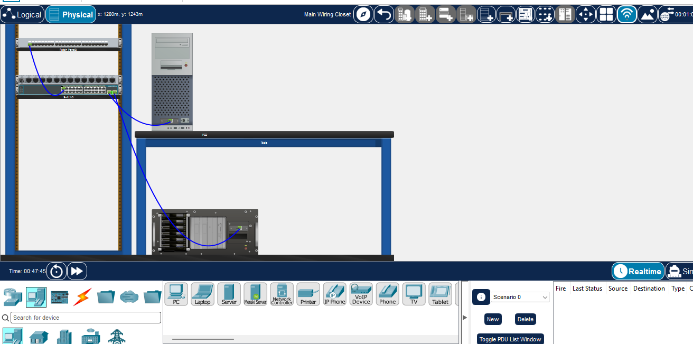
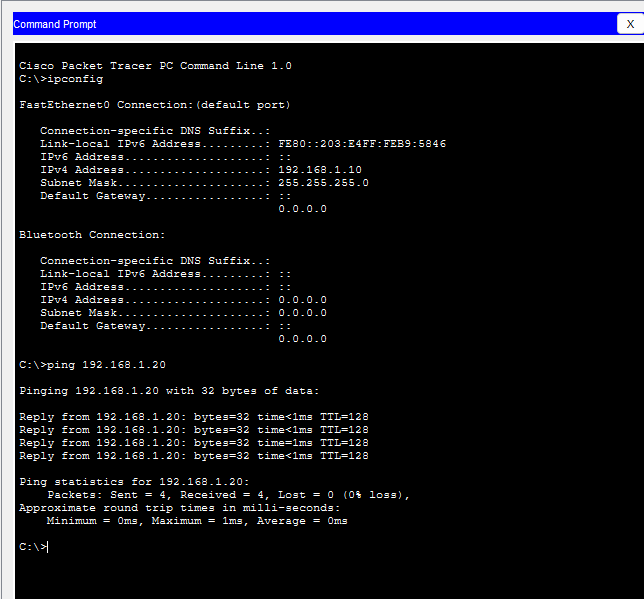

# Physical Server Rack & Cabling Lab | Cisco Packet Tracer

## Project Overview

This is a beginner-level networking lab that I completed using Cisco Packet Tracer. The purpose of this project was to understand basic data center rack setup, network cabling, port labeling, IP configuration, and connectivity testing.

## Tools and Components

- Cisco Packet Tracer
- Simulated 42U Server Rack
- Cisco Catalyst 2960 Switch
- Copper Patch Panel
- Server and PC
- Ethernet cables

## Lab Implementation

### 1. Physical Rack Setup

- Used the Physical Workspace in Cisco Packet Tracer.
- Arranged the networking devices in a rack layout.
- Identified the roles of the switch, patch panel, server, and PC.

### 2. Cabling and Port Labeling

- Practised connecting the patch panel to the network switch.
- Used Ethernet cables for network connectivity.
- Documented the connection using a switch interface description.

**Connection label:**

`PP0.Port1 ⇄ SW0.Fa0/1`

**Switch port description:**

`PP0-Port1-to-Switch-Fa0/1`

### 3. IP Configuration

| Device | IP Address | Subnet Mask |
|---|---|---|
| PC | 192.168.1.10 | 255.255.255.0 |
| Server | 192.168.1.20 | 255.255.255.0 |

### 4. Connectivity Testing

Performed ping tests between the PC and server.

**Result:** Successful ping responses confirmed that both devices could communicate over the configured network.

## Lab Screenshots

### Physical Rack and Cabling View

### Successful Ping Test

## Key Learnings

- Basic physical rack layout and equipment placement.
- Understanding switch and patch panel connections.
- Ethernet cabling and port labeling.
- Static IP address configuration.
- Verifying connectivity using the `ping` command.
- Basic networking documentation and troubleshooting.

## Conclusion

This hands-on lab helped me build a basic understanding of physical networking and data center cabling concepts. I plan to continue learning server hardware troubleshooting, Linux administration, and network operations.

**Project Type:** Hands-on Networking Lab  
**Tool:** Cisco Packet Tracer  
**Level:** Beginner
